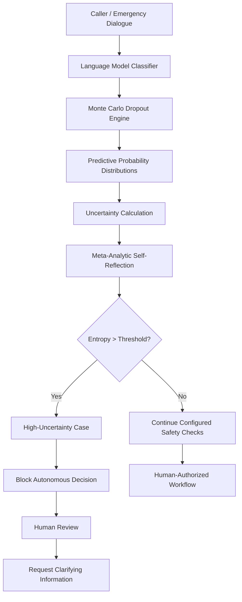
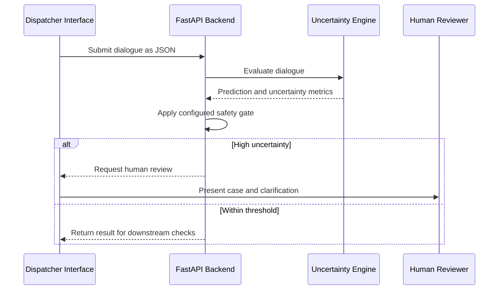

# QUEST — Quantifying Uncertainty in Emergency System Triage

<p align="center">
  <strong> An advanced AI assistant prototype designed to support emergency dispatchers by quantifying epistemic uncertainty in real time and dynamically triggering human in the loop oversight.</strong>
</p>

---

## 1. What Is QUEST?

**QUEST** stands for **Q**uantifying **U**ncertainty in **E**mergency **S**ystem **T**riage.

QUEST is a research grade practice oriented emergency triage prototype devised to address epistemic uncertainty and fragmented human-machine coordination in emergency dispatch workflows while exploring how uncertainty aware language models can assist humans in high-stakes situations.

Traditional deep learning classifiers produce predictions that can appear confident even when the input is incomplete, ambiguous, or outside the distribution encountered during training.

QUEST investigates an alternative approach by combining:

- **Epistemic uncertainty quantification** using Monte Carlo Dropout.
- **Meta-analytic self-reflection** to evaluate model outputs against a predefined safety threshold.
- **Human-in-the-Loop (HITL) oversight** when uncertainty exceeds that threshold.
- **Targeted clarification prompts** intended to help gather additional contextual information.

Rather than treating every prediction as reliable, QUEST is designed to identify situations in which the model's output should not be relied upon without further assessment.

> [!IMPORTANT]
> QUEST is an experimental research prototype, not a clinically validated medical device. Its predictions must not replace emergency services, qualified dispatchers, or medical professionals.

---

## 2. Core Operational Capabilities

| Capability | Description |
|---|---|
| **Multi-Turn Dialogue Evaluation** | Processes written emergency caller and dispatcher transcripts across dialogue turns. |
| **Uncertainty Quantification** | Calculates predictive entropy and measures variability across stochastic model passes. |
| **Meta-Analytic Self-Assessment** | Compares predictive entropy against a configured safety threshold. |
| **Risk-Aware Gating** | Routes high uncertainty cases for human review rather than treating the prediction as sufficient for autonomous action. |
| **Clarification Prompts** | Suggests follow up questions to help gather additional information. |
| **API-Oriented Design** | Specifies a potential deployment interface using FastAPI and structured JSON responses. |

---

## 3. Why This Research Matters

Emergency medical dispatch involves incomplete information, time pressure, and potentially severe consequences when symptoms are misunderstood.

For example, a caller might initially report:

> "My relative doesn't feel well."

This statement provides insufficient context for a dependable severity assessment. A conventional classifier may still generate a label, but generating a label does not establish that the prediction is trustworthy.

QUEST investigates a **safe-fail approach** in which uncertainty becomes an explicit part of the decision process.

Instead of treating automation as an all or nothing decision, the system evaluates whether its output meets a configured uncertainty criterion and escalates cases that require additional human assessment.

### Research Motivation

- **Reliability:** Detect predictions that remain highly uncertain.
- **Transparency:** Expose quantitative metrics associated with a model's output.
- **Human oversight:** Make uncertainty a trigger for review rather than hiding it behind a single predicted label.
- **Responsible automation:** Avoid treating an unvalidated model prediction as sufficient justification for a high-stakes action.

---

## 4. Core Research Question

> **How can artificial intelligence systems dynamically quantify their own epistemic uncertainty and determine when to transition from automated processing to human-in-the-loop intervention in high-stakes, ambiguous environments?**

QUEST explores this question through uncertainty estimation, threshold based safety gating, and multi-turn clarification workflows.

---

## 5. Dataset Information and Justification

### Dataset Description

The dataset source used for streaming medical dialogue samples is **MedDialog** accessed via Hugging Face as a source of medical dialogue data for experimentation.

Each record consists of multi turn dialogue exchange between emergency dispatchers and callers, labeled across three clinical severity tiers:

| Severity Tier | Category | Description | Example |
|---|---|---|---|
| **Low** | Category 3 | Non-life-threatening conditions | Minor lacerations or mild fever |
| **Medium** | Category 2 | Urgent conditions requiring medical evaluation | Severe abdominal pain or high fever with lethargy |
| **Critical** | Category 1 | Potentially life-threatening emergencies | Severe breathing difficulty, acute chest pain, or loss of consciousness |

*These severity descriptions illustrate the intended task categories. They are not clinical diagnostic rules.*

### Justification for Use

**1. Clinical ambiguity**

Emergency conversations may begin with fragmented descriptions that provide insufficient information for confident classification.

**2. Safety-critical decision support**

Triage provides a useful research setting for investigating when uncertain model predictions should be escalated for human review.

**3. Multi-turn evaluation**

Sequential dialogue can be used to investigate how predictive uncertainty changes as new contextual information becomes available.

> **Evaluation objective:** Measure whether uncertainty responds appropriately to new information rather than assuming that every additional dialogue turn will reduce it.

*Dataset note: The exact dataset version, preprocessing procedure, label mapping, and train/validation/test splits should be documented when these details are available.*

---

## 6. System Architecture and Detailed Mechanics

### High-Level Architecture

The following diagram illustrates the intended QUEST decision workflow.



**Core principle:** The model generates a prediction and an uncertainty estimate. A separate decision layer evaluates whether the output satisfies the configured uncertainty criterion.

Passing an entropy threshold alone does not establish clinical correctness or guarantee that a prediction is safe.

### Module 1: Epistemic Uncertainty Quantification (UQ)
To measure true model uncertainty (epistemic risk stemming from a lack of input data/context), QUEST implements **Monte Carlo Dropout** during the inference phase.

* **Stochastic Inference ($T=20$):** Rather than performing a single deterministic forward pass, internal dropout layers ($p=0.3$) remain active at test time. The system executes $T=20$ stochastic forward passes over the exact same input utterance:
  $$\hat{p}^{(t)} = \text{Softmax}(f_{\hat{\theta}^{(t)}}(x)) \quad \text{for } t \in \{1, \dots, T\}$$
* **Predictive Entropy $H(y|x)$:** The agent calculates the mean predictive distribution $\mu(x)$ and computes the total predictive entropy across all potential severity classes $C$:
  $$H(y|x) = -\sum_{c \in C} \mu_c(x) \log\left(\mu_c(x) + \epsilon\right)$$
  * *High Entropy ($H \to 1.0$):* Model predictions are evenly scattered across categories, signaling high confusion.
  * *Low Entropy ($H \to 0.0$):* Predictions consistently cluster around a single class, signaling high certainty.
* **Epistemic Class Variance:** Measures parameter dispersion across the $T=20$ passes to verify internal subnetwork agreement.

---

### Module 2: Meta-Analytic Self-Reflection Engine
The system features a dedicated meta-evaluation layer that intercepts model outputs before any decision is routed to dispatch infrastructure.

* **Safety Boundary Evaluation ($\tau = 0.5$):** The self-reflection node evaluates $H(y|x)$ against an empirically calibrated threshold $\tau = 0.5$.
* **Automated Safety Diagnostics:**
  * **If $H(y|x) > \tau$:** The reflection engine flags an explicit internal system warning:
    > `"HIGH_EPISTEMIC_RISK: Predictive entropy (H = 0.98) exceeds safety threshold (tau = 0.50). Autonomous classification halted. Human intervention required."`
  * **If $H(y|x) \le \tau$:** The reflection engine validates the signal:
    > `"SIGNAL_CONVERGED: Predictive entropy (H = 0.18) within safe operating bounds. Automated classification approved."`

---
### Module 3: Human-in-the-Loop (HITL) Safe-Fail Gating

When the uncertainty criterion is exceeded, QUEST is designed to route the case for human review and suggest clarification questions.

#### Illustrative Dialogue Scenario

<details>
<summary><strong>Turn 1 — Ambiguous initial signal</strong></summary>

**Caller**

> "Help, my relative is unwell and struggling to breathe."

**Intended system response**

- Calculate the predictive distribution and uncertainty.
- Check the result against the configured threshold.
- Request human review if the threshold is exceeded.
- Suggest appropriate follow-up questions for the dispatcher.

**Example clarification**

> Is the patient experiencing chest pain, tightness, or pain spreading to the arm?

</details>

<details>
<summary><strong>Turn 2 — Additional clinical context</strong></summary>

**Illustrative caller response**

> "Yes, he says his chest feels very tight and his left arm feels heavy."

The new information changes the input context. QUEST should recalculate its predictive distribution and uncertainty rather than assuming that uncertainty necessarily decreases.

</details>

<details>
<summary><strong>Turn 3 — Further context</strong></summary>

**Illustrative caller response**

> "It started suddenly about 10 minutes ago."

The system can reassess its output using the expanded transcript. Any triage designation and next steps must remain subject to qualified human assessment.

</details>

> [!NOTE]
> This dialogue describes an intended research scenario. The empirical results in Section 7 are reported separately, they do not demonstrate uncertainty collapsing below the threshold in this three-turn experiment.

---

### Module 4: Deployment Architecture

QUEST specifies a possible containerized REST API architecture.

| Component | Intended Role |
|---|---|
| `app.py` | FastAPI application for structured dialogue evaluation requests |
| `Dockerfile` | Container build configuration |
| `requirements.txt` | Python dependency specification |
| `/docs` | FastAPI's interactive API documentation when the service is running |

A potential request and response workflow is:



Deployment through Docker or a cloud service is an architectural objective. It should be described as implemented only after the application has been built, tested, and deployed successfully.

---

## 7. Empirical Output Analysis and Validation

The baseline experiment uses 20 MC Dropout passes to evaluate three emergency dialogue turns.

### Experimental Configuration

| Parameter | Configuration |
|---|---|
| **Model Backbone** | `distilbert-base-uncased` |
| **Model Architecture** | `DistilBertForSequenceClassification` |
| **Uncertainty Technique** | Monte Carlo Dropout |
| **Stochastic Passes** | `T = 20` |
| **Dropout Probability** | `p = 0.3` |
| **Number of Classes** | 3 — Low, Medium, Critical |
| **Theoretical Maximum Entropy** | `ln(3) ≈ 1.0986` |
| **Safety Threshold** | `τ = 0.50` |

### Results Across Dialogue Turns

| Turn | Predicted Class | Predictive Entropy | Reported Confidence | Safety Action |
|:---:|---|---:|---:|---|
| 1 | Critical | `1.0944` | `0.3747` | HITL triggered |
| 2 | Critical | `1.0943` | `0.3729` | HITL triggered |
| 3 | Critical | `1.0950` | `0.3691` | HITL triggered |

### Pipeline Execution Log

<details>
<summary><strong>Turn 1 — Critical prediction</strong></summary>

```text
[TURN 1] Triage Prediction: Critical

Entropy   : 1.0944
Confidence: 0.3747

Safety Evaluation:
Predictive entropy exceeds the threshold of 0.50.
Autonomous dispatch is halted and human review is triggered.

Clarification:
Does the patient experience chest pain or pressure
radiating to the arm or jaw?
```

</details>

<details>
<summary><strong>Turn 2 — Critical prediction</strong></summary>

```text
[TURN 2] Triage Prediction: Critical

Entropy   : 1.0943
Confidence: 0.3729

Safety Evaluation:
Predictive entropy exceeds the threshold of 0.50.
Human review remains active.

Clarification:
When did these symptoms first start,
and are they continuous?
```

</details>

<details>
<summary><strong>Turn 3 — Critical prediction</strong></summary>

```text
[TURN 3] Triage Prediction: Critical

Entropy   : 1.0950
Confidence: 0.3691

Safety Evaluation:
Predictive entropy exceeds the threshold of 0.50.
Human review remains active.

Clarification:
Can you provide additional clinical history?
```

</details>

### Interpretation of the Results

**1. Predictive entropy remains near its theoretical maximum.**

For a three-class distribution, the theoretical maximum entropy is approximately `1.0986`. All three reported values remain close to that maximum.

**2. Every reported entropy value exceeds the configured threshold.**

The values range from `1.0943` to `1.0950`, substantially above the threshold of `0.50`. Under the stated decision rule, all three turns trigger human review.

**3. The reported confidence is relatively low.**

The reported confidence values range from `0.3691` to `0.3747`. Together with the entropy values, this suggests that the aggregate predictive distribution is relatively diffuse, assuming confidence is defined as the maximum class probability.

**4. Uncertainty does not visibly decrease across the three reported turns.**

The data show persistently high uncertainty rather than convergence. These observations do not demonstrate that additional dialogue turns necessarily reduce entropy.

### Safety-Gate Summary

| Validation Check | Result |
|---|---|
| Entropy exceeds `0.50` on Turn 1 | Yes |
| Entropy exceeds `0.50` on Turn 2 | Yes |
| Entropy exceeds `0.50` on Turn 3 | Yes |
| All turns trigger HITL under the stated rule | Yes |
| Entropy decreases consistently over all turns | Not demonstrated |
| Clinical diagnostic accuracy established | Not established |

### Metric Validation

The supplied execution log previously reported variance as `0.000000` while describing it as "high model variance." These statements are inconsistent.

Before making claims about model disagreement, verify that the implementation:

- Enables dropout during every stochastic inference pass.
- Performs the configured number of passes.
- Calculates the mean predictive distribution correctly.
- Calculates entropy from the mean class probabilities.
- Computes variance across stochastic outputs rather than across a single deterministic result.
- Defines confidence consistently, such as maximum mean class probability.
- Uses a threshold that has been evaluated and justified on validation data.

> [!IMPORTANT]
> These results demonstrate the reported threshold triggering behavior only. They do not establish calibrated uncertainty, correct triage classifications, improved clinical outcomes, or clinical safety.

---

## 8. Key Contributions and Advantages

### Calibrated Safety-Oriented Workflow

The system makes predictive uncertainty part of its decision workflow and provides a mechanism for routing high-uncertainty cases to human review.

### Quantitative Transparency

Entropy and confidence values make the output easier to inspect and audit than a predicted class label alone.

### Structured Human-AI Collaboration

QUEST explores a workflow in which the AI provides predictions and clarification prompts while human professionals retain responsibility for the clinical assessment.

### Multi-Turn Reassessment

The architecture supports reassessing model outputs as new dialogue information arrives, allowing uncertainty to be monitored throughout a conversation.

| Contribution | Intended Benefit |
|---|---|
| Explicit uncertainty metrics | Greater visibility into prediction ambiguity |
| Threshold based gating | Consistent application of the configured review rule |
| Clarification workflow | Structured collection of further context |
| Multi-turn assessment | Analysis of how predictions change across dialogue turns |

---

## 9. Limitations

| Limitation | Description |
|---|---|
| **Text Based Processing** | The current design processes written transcripts rather than raw speech acoustics, vocal stress, or prosody. |
| **Static Threshold** | The current configuration uses a fixed threshold of `τ = 0.50`. |
| **Calibration Not Established** | The reported outputs alone do not demonstrate that uncertainty values are calibrated against observed error rates. |
| **Evaluation Scope** | Three logged dialogue turns are insufficient to establish general performance or robustness. |
| **Clinical Validation** | The prototype has not been established as a clinical grade medical device. |
| **Variance Calculation** | The reported zero variance and its interpretation require verification. |
| **Dataset Reproducibility** | The exact dataset version, split strategy, and label generation procedure should be documented for reproducibility. |

---

## 10. Future Research Directions

### Multimodal Audio Analysis

Explore acoustic information such as pause duration, speaking rate, vocal agitation, and tone alongside transcript text.

### Evaluation on Real-World Dispatch Data

Evaluate the system using appropriately governed emergency dispatch data, with a documented annotation and validation process.

### Active Learning and Information Gain

Investigate question snd selection strategies that choose clarification prompts based on expected information gain.

One possible research objective is:

\[
q^* = \arg\max_q
\left[
H(Y\mid D) -
\mathbb{E}_{a\sim P(a\mid q,D)}
H(Y\mid D,q,a)
\right]
\]

where:

- \(D\) is the dialogue collected so far.
- \(q\) is a candidate clarification question.
- \(a\) is the possible response.
- \(H(Y\mid D)\) is the current predictive entropy.

This objective expresses the expected reduction in predictive entropy from asking a question. In practice, question selection must also account for clinical relevance, feasibility, urgency, and the risk of delaying emergency care.

### Adaptive Safety Thresholds

Study methods for selecting and validating thresholds using representative validation datasets, class-specific error rates, and the consequences of different types of misclassification.

### Broader Experimental Validation

Evaluate the prototype using:

- Larger held-out datasets.
- Multiple random seeds.
- Calibration and selective-prediction metrics.
- Error analysis by severity category.
- Ablation studies comparing deterministic inference with MC Dropout.
- Human review of clarification quality and operational usefulness.

---

## 11. Technical Requirements and Environment Setup

### Hardware

- NVIDIA CUDA compatible GPU, where available.
- Google Colab GPU runtime as an alternative experimental environment.
- CPU execution may be possible, but inference can be slower.

### Core Dependencies

| Technology | Intended Purpose |
|---|---|
| Python 3.9+ | Application development |
| PyTorch | Model inference and dropout operations |
| Hugging Face Transformers | Pretrained language model and tokenizer |
| NumPy | Numerical calculations |
| Pandas | Structured result analysis |
| Matplotlib | Experimental visualizations |
| FastAPI | REST API implementation |
| Uvicorn | ASGI application server |
| Docker | Containerization |

### Environment Setup

Clone the repository:

```bash
git clone https://github.com/YOUR-USERNAME/YOUR-REPOSITORY.git
cd YOUR-REPOSITORY
```

Create and activate a virtual environment:

```bash
python -m venv .venv
```

On macOS or Linux:

```bash
source .venv/bin/activate
```

On Windows:

```powershell
.venv\Scripts\activate
```

Install the project's dependencies:

```bash
pip install -r requirements.txt
```

Start the API after confirming that `app.py` implements the application:

```bash
uvicorn app:app --reload
```

If the application starts successfully, the interactive API documentation is typically available at:

```text
http://127.0.0.1:8000/docs
```

*These are setup instructions for the proposed project structure. Successful installation and execution depend on the actual contents of the repository and dependency file.*

---

## 12. Repository Structure

The intended repository layout is:

```text
QUEST/
│
├── README.md
├── app.py
├── requirements.txt
├── Dockerfile
│
├── assets/
│   └── predictive_entropy_by_turn.png
│
├── notebooks/
│   └── experiments.ipynb
│
└── .gitignore
```

| File or Directory | Purpose |
|---|---|
| `README.md` | Project overview, architecture, results, and documentation |
| `app.py` | FastAPI backend, if implemented |
| `requirements.txt` | Python dependencies |
| `Dockerfile` | Container configuration |
| `assets/predictive_entropy_by_turn.png` | Optional graph of the reported entropy values |
| `notebooks/experiments.ipynb` | Optional experimental notebook |
| `.gitignore` | Excludes virtual environments, caches, secrets, and generated files |

The notebook and asset paths are suggested organizational choices. Include them in the repository only when the corresponding files exist.

---

## 13. Safety and Research Disclaimer

> [!CAUTION]
> **QUEST is an experimental research prototype, not a medical device or a replacement for emergency services.**

- Model predictions may be incorrect even when uncertainty is low.
- High predictive uncertainty does not identify the correct diagnosis.
- A threshold triggered review does not itself guarantee a safe outcome.
- Clinical decisions must remain with qualified professionals using appropriate emergency protocols.
- Any future clinical use would require rigorous technical, clinical, ethical, and regulatory evaluation.

### Research Goal

QUEST explores a transparent, uncertainty aware approach to AI assisted emergency dialogue processing, with emphasis on identifying uncertain predictions and supporting human oversight.

**The goal is not to replace human judgment, but to investigate how uncertainty can make AI assisted decision workflows more accountable.**

---

<p align="center">
  <strong>QUEST — Uncertainty Aware AI for Human-Centered Emergency Decision Support</strong>
</p>

<p align="center">
  <sub>Research prototype · Experimental evaluation · Human oversight</sub>
</p>
